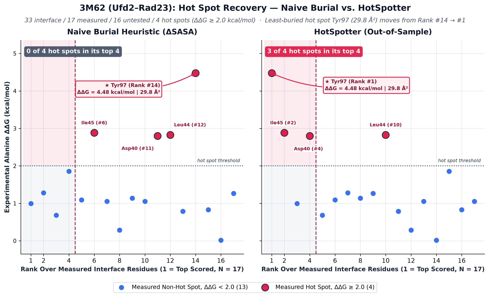
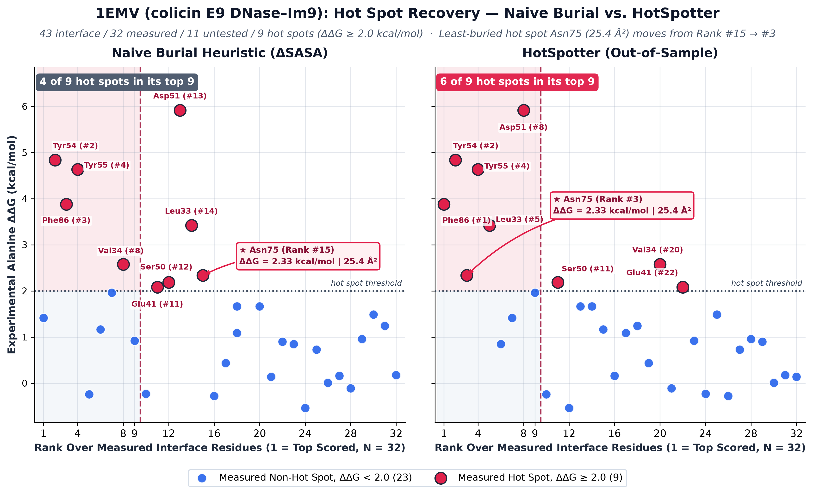

# HotSpotter

Protein-protein interactions (PPIs) orchestrate nearly every essential biological pathway, making them prime targets for therapeutic intervention. Within these interfaces, a fraction of critical amino acids—known as "hot spots"—contribute the vast majority of the binding energy. While identifying these structural anchors is a crucial first step in drug discovery, experimental wet-lab validation is notoriously slow and expensive.

**HotSpotter** predicts these energetic anchors (ΔΔG 2.0 kcal/mol) directly from a single 3D crystal structure. The naive heuristic in structural biology is burial: assuming the most deeply buried residues matter most. But burial measures contact area, not thermodynamic energy, which frequently points wet-lab experiments toward the wrong residue. To build a more rigorous filter, HotSpotter ranks interface residues using an L1-regularized XGBoost model. Trained on experimental G measurements from the SKEMPI 2.0 database, the model evaluates 30 hand-built structural and evolutionary features—including interaction chemistry, burial, van der Waals packing, conservation, and side-chain mobility—to capture the true physics of the interface better than surface area alone.


## Results

1,570 alanine-scanned residues across 172 complexes (SKEMPI 2.0, ΔΔG ≥ 2.0 kcal/mol = hot).
Cross-validation is **grouped by complex**, so no residue is scored by a model that has seen
another residue from the same interface. 5 folds × 5 seeds.

| | Naive (buried area) | HotSpotter |
|---|---|---|
| PR-AUC | 0.3927 | **0.5629** |
| ROC-AUC | 0.6639 | **0.7936** |
| ROC-AUC, literature definition <sup>1</sup> | 0.7020 | **0.8625** |
| Top-1 hit rate <sup>2</sup> | 60.0% | **78.2%** |
| Top-3 hit rate | 80.0% | **93.3%** |

<sup>1</sup> hot > 2.0 kcal/mol, non-hot < 0.4, grey zone dropped — the filtering used by published methods.
<sup>2</sup> fraction of complexes whose top-*k* ranked residues contain a true hot spot.

**3M62 (Ufd2–Rad23).** Tyr97 is the strongest hot spot in the interface (ΔΔG 4.48 kcal/mol)
but only the 14th most buried of the 17 residues SKEMPI measured there. With 3M62 and its
close homologs held out of training, HotSpotter ranks it **#1** — while the most buried of
those 17, Phe9, is not a hot spot at all (ΔΔG 0.99).



**1EMV (colicin E9 DNase–Im9).** The most completely scanned interface in the set, so
little is unknown: 32 of its 43 interface residues were measured. Burial finds 4 of the
9 hot spots in its top nine; HotSpotter finds 6.



Both figures rank only the measured residues — an unmeasured residue in a method's top *k*
is neither a hit nor a miss — and each complex is removed from training along with
everything sharing ≥70% chain identity with it before being scored.

**Split audit.** `scripts/audit_splits.py` holds data, features, model and seeds fixed and
varies only the fold grouping.

| Fold grouping | PR-AUC | Estimates performance on |
|---|---|---|
| random residue split | 0.5675 | an interface already partly scanned |
| by complex | 0.5560 | a new complex |
| by ≥70% chain-identity cluster | 0.5585 | a new complex with no close relative in training |

Keeping homologous complexes out of the same fold costs nothing measurable — the
differences sit inside fold-to-fold noise — so the model is not relying on near-duplicate
entries.

**Ceiling.** Residues that are near-identical across all 30 features still differ in ΔΔG by
1.23 kcal/mol on average, 2.5× the experimental error, so most remaining error is
information a single bound structure does not contain (`scripts/diagnose_ceiling.py`).

## Approach

Each layer was kept only if it improved grouped cross-validation:

1. **Structure → features.** Interface detection, then per-residue interaction chemistry
   (salt bridges, hydrogen bonds, aromatic and hydrophobic contacts), burial and topology.
2. **Learned ranking.** XGBoost with L1 regularization on SKEMPI alanine-scan labels.
3. **Physics and evolution.** Lennard-Jones packing energy, ConSurf conservation (missing
   values passed through, because they are not missing at random), and side-chain
   mobility relative to the backbone.
4. **Tested and rejected** (`experiments/`): a GATv2 graph network, ESM-2 embeddings,
   implicit-solvent electrostatics, and an XGBoost + extra-trees ensemble that won only
   when homologs were allowed to straddle folds.

## Usage

```bash
pip install -e .

python scripts/run_demo.py                                  # feature pipeline on barnase–barstar
python scripts/evaluate.py                                  # reproduce the tables above
python scripts/audit_splits.py                              # what the fold grouping is worth
python scripts/infer_xgb.py --pdb 3M62 --chains A,B         # rank one complex
python scripts/viz.py --pdb 3M62 --chains A,B \
    --preds predictions/3m62_xgb_predictions.csv --out 3m62.html
```

The training table and fixed folds ship in `data/`; rebuilding the table from SKEMPI
(`scripts/build_features.py`) downloads several hundred structures and takes hours.
